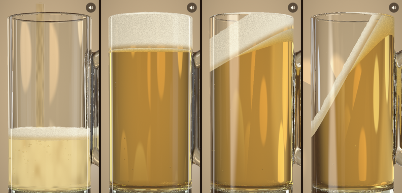

# ビールジョッキ



スマホそのものをビールジョッキに見立てるブラウザアプリです。
開くと画面いっぱいのジョッキに、ビールが泡と一緒に注がれます。
スマホを傾けると液面は水平を保ったまま動き、縁を越えたぶんが「ゴクゴク」と飲まれて減っていきます。

ガラスの屈折、ビールの琥珀色、泡、液の中を上る炭酸の泡までを、1 枚のフラグメントシェーダーでレイトレースして描いています。
[three.js](https://threejs.org) と [Vite](https://vite.dev) で作りました。
作り方は同じ作者の [ラムネ](https://github.com/Kawade502/ramume) を土台にしています。

## 動かし方

```bash
npm install
npm run dev
```

http://localhost:5184 を開きます。

公開版：https://kawade502.github.io/beer-jug/ （`main` に push すると [GitHub Actions](.github/workflows/pages.yml) が自動でビルドして公開します）

| 操作 | 動き |
| --- | --- |
| 開く | 空のジョッキにビールが注がれる |
| 「乾杯！」をタップ | 音が出るようになり、スマホでは傾きセンサーを使い始める（iPhone は許可を聞かれる）。そのときの持ち方を「まっすぐ」とみなす |
| スマホを傾ける | 前後左右どちらに傾けても、液面と泡は水平のまま。縁を越えると飲める |
| 右上の水平器ボタン | 今の持ち方を「まっすぐ」にし直す |
| ドラッグ、または **←** **→** **↑** **↓** | パソコンで傾ける（左右と前後）。離すと揺れながら戻る |
| 「おかわり」、または **R** | もう一杯注ぐ |
| **M**、または右上のボタン | 音を消す／出す |

## 仕組み

**ジョッキ = スマホ。** ジョッキのローカル座標をスマホ本体と同じ向き（x 右、y 上、z 手前）にして、カメラは本体に固定しています。
スマホを傾けて変わるのは「重力の上向き」だけです。[`src/tilt.js`](src/tilt.js) が傾きセンサーの beta/gamma から本体の座標での上向きを出します。

- 傾けると OS が画面を自動で横向きにするが、そのぶん中身を逆に回すので、ジョッキは本体に貼り付いたまま。横向きかどうかは画面の形（横長か）で、どちらへ倒したかは重力の向きで決める（iPhone は回る途中で角度の値が古いことがあるため）
  - 逆に回している間も、ジョッキの大きさ（1mm あたりの画素数）は縦向きのときと同じにし、ノッチなどの余白は本体の辺に合わせて付け替える
  - センサーがない間（乾杯の前、許可されなかったとき）は OS の回転だけが重力の手がかりなので、逆に回さない。乾杯の前に横向きにすると、縦に持って乾杯するよう案内する
  - 自然な向きが横のタブレットでは、逆に回さず、センサーの値を画面の向きへ回す
- Android の Chrome などでは、乾杯したときに全画面にして縦向きに固定する
- iPhone は回転を止められないので、画面がいったん回ってから戻る。一度だけ「画面縦向きのロック」を案内する
- 持ち方の補正は、画面がどれだけ寝ているか（重力の画面に垂直な成分）だけで決めるので、横持ちで乾杯しても縦に戻せばまっすぐになる

- スマホはふだん少し寝かせて持つので、乾杯したときの前後の傾きを「まっすぐ」とみなす（端末の x 軸まわりに回して補正する。方位には関係しない）
- 液面は上向きを、ばねで少し遅れて追う。急に傾けると行き過ぎて戻り、ちゃぷんと揺れる
- 背景と光は重力の側に固定してあるので、傾けると映り込みが流れる

**液面と泡。** [`src/jug.js`](src/jug.js) は、ラムネと同じく「体積が変わらない水平な面」の高さを二分法で解きます。
ジョッキを高さごとの輪切りにし、それぞれの円が面より下にある部分の面積を足して体積を出します。

- 液面：ビールの体積から
- 泡の上面：ビール＋泡の体積から。立てているときだけ、縁の上に 10mm まで盛り上がれる
- 縁のいちばん低いところ（上向きに測った高さ）を液面が越えたら、越えた高さの 1.5 乗に比例して流れ出る。泡が先に縁に届くので、泡から先に減る

**注ぐ・飲む。** [`src/beer.js`](src/beer.js) が中身を受け持ちます。

- 注ぐ：6.5 秒かけて注ぎ、勢いで泡が立つ。満ちるほど泡の割合が増え、注ぎ終わると 3 秒ほどで落ち着く
- 注いだ直後はビール全体が細かい泡で濁り、だんだん澄んでいく
- 炭酸：ジョッキの底と壁の決まった場所から、泡が列になって上る
- 飲む：0.5 秒ごとに「ゴクッ」。そのうち 0.34 秒の間だけ縁からビールが流れ込むので、液面が脈打つように下がる
- たくさん飲んで口を離すと「ぷはー」。残りが 6ml を切ったら「ごちそうさま」

**光。** [`src/shader.js`](src/shader.js) が画面の 1 ピクセルごとに光線を飛ばします。

- 光線は空気→ガラス→ビール→ガラス…と面を越えるたびに、フレネル反射と屈折に分かれる
- ガラスとビールは、通った距離のぶん色を吸収する。ビールは青をよく吸うので、厚いところほど濃い琥珀色になる
- 泡の層は、ガラスに押し付けられた泡の膜の模様（ボロノイ）を描く。液面に近いほど泡が大きく、ビールの色がのぞく
- 液面、炭酸の泡、注ぐ流れは式で直接交点を求め、ガラスと泡の層は距離場をたどって探す
- 光線の行き先は居酒屋。ジョッキの後ろのやわらかく明るい壁、店の明かりのぼけ、木のカウンターがある

**音。** [`src/sound.js`](src/sound.js) は、音声ファイルを使わずに Web Audio で合成しています。

- トクトク：落ちる流れのザーッと、泡のポコポコ。ジョッキの中の空気の共鳴（長さの 4 倍の波長）を通すので、満ちるほど音程が上がる
- ゴクッ・コポッ・ズズッ（泡を吸う）・ぷはー・シュワシュワ
- カチン（乾杯）、コトッ（おかわり）

ブラウザの決まりで、最初にタップかキーを押すまでは音が出ません。

**省エネ。** 動いている間は低い解像度で描いて引き伸ばし、フレームが重ければ自動でさらに下げます。
傾けていないときは 2 フレームに 1 回だけ描きます。飲み干して止まったら描画を休みます。

## 確かめ方

`?test` を付けて開くと描画ループが止まり、`window.__beer` から時間を進めたり傾けたりできます。
[`scripts/shot.mjs`](scripts/shot.mjs) は Playwright と Chromium のソフトウェア描画（SwiftShader）で、いくつかの場面を `shots/` に撮り、液量などの数値も書き出します。

```bash
npm run build && npx vite preview &
npm run shot   # playwright が別の場所にあるときは PLAYWRIGHT=… で渡す
```

## ファイル

```
src/
├── main.js     レンダラー、入力、描画ループ、画面の文字
├── jug.js      ジョッキの寸法と輪郭、液面と泡の面の計算、縁の高さ
├── beer.js     注ぐ・泡・炭酸・飲む
├── tilt.js     傾きセンサーと、パソコンでの傾け方
├── shader.js   シーン全体のレイトレース（GLSL）
├── sound.js    効果音の合成
└── style.css
```

AI（Claude）とのバイブコーディングで作りました。
